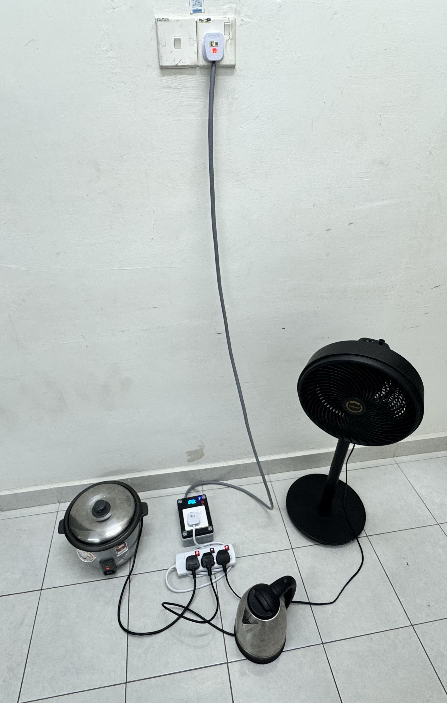
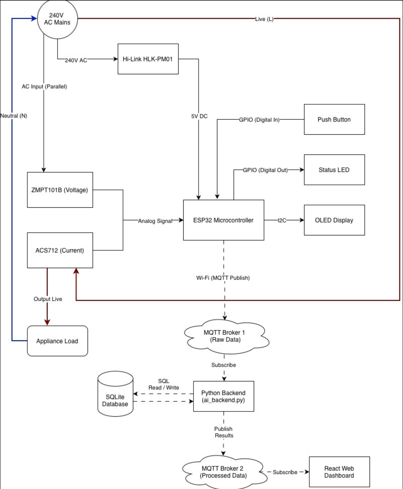
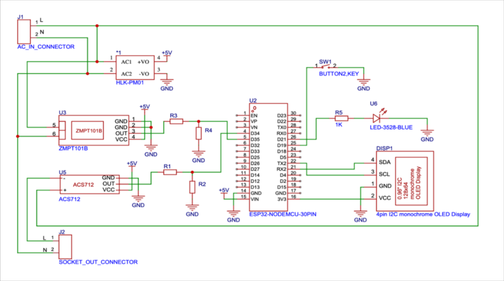
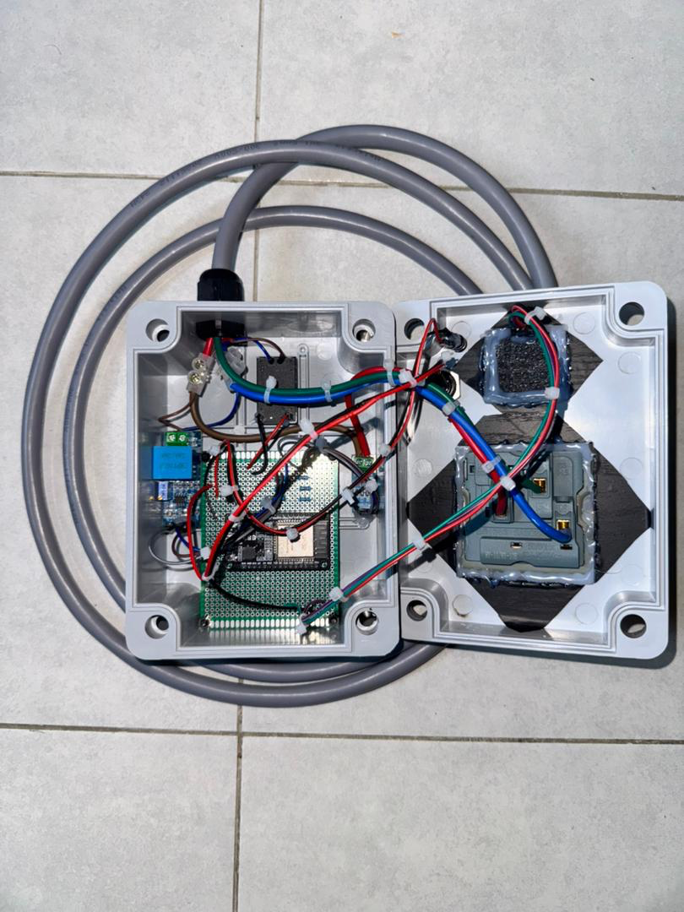
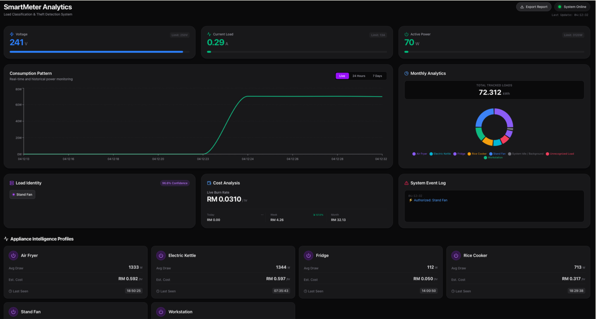
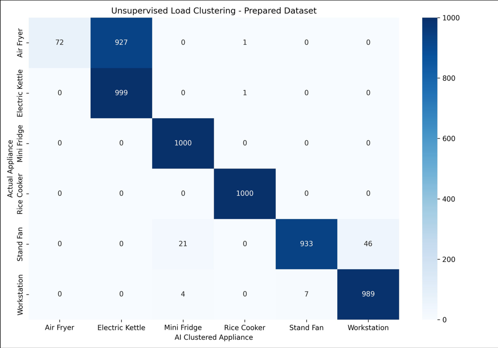
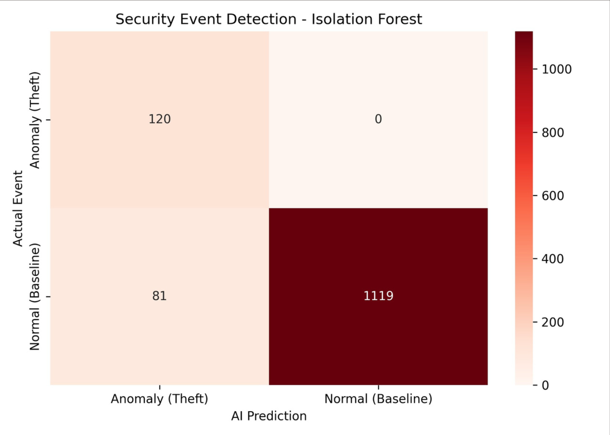

# Smart Energy Meter with Consumption Pattern Analysis and Theft Detection

An ESP32-based energy meter that sits between a wall socket and a 3-outlet extension socket. It measures the combined voltage and current of everything plugged in, works out which appliances are running with machine learning, flags unrecognized (parasitic) loads and shows live power and cost on a web dashboard using Malaysian (TNB) tariff rates.

Final Year Project (solo), Bachelor of Computer Engineering, Universiti Malaysia Perlis (UniMAP), 2025/2026.
**Supervisor:** Assoc. Prof. Ts. Dr. Ku Nurul Fazira Ku Azir

> The project was completed in July 2026. This repository was organized and published in November 2026.

> **Safety warning:** this project measures **240 V AC mains voltage**. It is shared to show the design, not as a build guide. Do not build or connect it unless you are qualified to work with mains electricity.

[Demo video](https://youtu.be/hBfx_ivtnr0)


## Problem

- **No per-appliance detail:** standard meters show only whole-house totals, so inefficient appliances can't be identified.
- **No active security:** passive meters can't detect line tapping or parasitic loads in real time.
- **Abstract numbers:** users see kWh and watts instead of what it costs in ringgit (MYR).

## Objectives and Scope

- Build an ESP32 edge node for high-resolution voltage and current acquisition.
- Build a two-model machine-learning backend (K-Means and Isolation Forest) for load identification and theft detection.
- Evaluate the system through a web dashboard with real-time TNB cost analytics.

**Scope:** single-phase 240 V AC from one wall plug with a standard 13 A fuse (3,120 W limit), feeding a 3-outlet extension socket. Several appliances can run at the same time as long as their combined current stays within that limit. Six target appliances, React, MQTT and SQLite.

| Category | Target appliances |
|---|---|
| Resistive loads | Air fryer, electric kettle, rice cooker |
| Inductive loads | Mini fridge, stand fan |
| Switched-mode power supply (SMPS) | Workstation (PC) |

## System Architecture



```
ESP32 ──(MQTT: smartmeter/nazrul_final/raw)──▶ Python backend ──(MQTT: smartmeter/nazrul_final/processed)──▶ React dashboard
                                                   │
                                                   └──▶ SQLite (energy_logs.db)
```

1. **Perception layer (ESP32):** samples voltage and current, filters the readings and publishes them to the `raw` topic.
2. **Middleware (MQTT broker):** separates the mains-connected hardware from the compute-heavy machine learning.
3. **Application layer (Python backend):** subscribes to `raw`, logs to SQLite, runs the models, adds cost and chart data, and publishes the result to the `processed` topic.
4. **Dashboard (React):** subscribes to `processed` over WebSockets and displays it.

### MQTT messages

Raw message from the ESP32 (example values):

```json
{"voltage": 240.1, "current": 1.52, "power": 365.0}
```

Processed message from the backend:

| Field | Meaning |
|---|---|
| `voltage`, `current`, `power` | Live readings passed through |
| `appliance` | Identified appliance(s), or "System Standby" |
| `confidence` | Confidence of the load identification |
| `anomaly` | `true` when an unrecognized load is detected |
| `financials` | Live rate, daily, weekly and monthly cost, monthly kWh and trends |
| `leaderboard` | Share of energy by appliance this month |
| `chart_history` | Hourly (last 24 h) and daily (last 7 days) energy |
| `profiles` | Per-appliance average power, last seen time and cost per hour |

The project uses the free public broker `broker.hivemq.com` (no login) for demonstration. Anyone can publish to a public broker, so a real deployment should use a private broker with authentication and unique topic names.

## Hardware

| Component | Purpose |
|---|---|
| ESP32 Dev Module | Edge node: sampling, filtering, WiFi and MQTT |
| ZMPT101B | Mains voltage sensing, wired in parallel (GPIO 35) |
| ACS712 | Current sensing, in series with the load (GPIO 34) |
| HLK-PM01 | Steps mains down to 5 V so the ESP32 runs from the same outlet |
| SH1106 OLED (128x64, I2C) | Local display of live data and system info |
| Push button (GPIO 25) and status LED (GPIO 26) | Page switching and WiFi setup, connection status |





## Firmware (ESP32)

Written in the Arduino framework (`firmware/esp32/`).

- **Zero-offset calibration at boot:** takes 1,000 samples per sensor with nothing connected to find each sensor's baseline.
- **Software calibration:** voltage and current multipliers (0.795 and 0.01094) were tuned against a commercial multimeter. The result is about 0.5% error for both voltage and current.
- **Custom EMA filter with "snap" logic:** a standard exponential moving average (alpha = 0.05) lags behind sudden changes, so large jumps (over 0.5 A or 5 V) bypass the filter and are taken immediately. This keeps transitions sharp for the AI.
- **Connectivity handling:** if WiFi or MQTT drops, sampling stops while the board reconnects, so stale data is not published.
- **WiFi setup without reflashing:** hold the button for 5 seconds to open a setup portal (`SmartMeter_Nazrul`) using WiFiManager. A short press switches the OLED between live data and system info (IP, signal strength, uptime).

[Firmware flowchart](docs/firmware_flowchart.png)

## Backend (Python)

`backend/ai_backend.py` handles MQTT, the models, logging and the financial calculations.

### Event detection

The meter only sees the **total** current and power on the line, not each outlet. So the backend watches for a power step of at least 30 W and waits 3 seconds for the reading to settle. It then looks at the change (the delta) in current and power to identify which appliance was just switched on.

### Models

| Model | Job | Input features |
|---|---|---|
| **K-Means** | Identify the appliance (unsupervised load identification) | Voltage sag, delta current, delta power, calculated resistance |
| **Isolation Forest** | Detect unrecognized or parasitic loads | Voltage sag, delta current, delta power |

- Calculated resistance is what separates appliances with similar wattage.
- Isolation Forest was trained on 6,000 normal rows (known appliances) and 600 synthetic anomalies (simulated parasitic loads).
- **Multiple appliances at once:** measured power is split between running appliances in proportion to their detected load.
- **No lost energy during the 3-second wait:** readings taken while an event is still being identified are stored as "Scanning..." and reassigned to the correct appliance once it is known (retroactive backfilling).

[Backend flowchart](docs/backend_flowchart.png)

### Cost calculation

The backend mirrors the Malaysian component-based tariff: an energy charge of RM 0.2703 per kWh, switching to RM 0.3703 above 1,500 kWh, plus capacity and network charges. Daily, weekly and monthly totals come from SQLite.

## Dashboard (React)

`dashboard/` is a React app built with Vite and Tailwind.



- Rolling 60-second power graph that shows transient spikes
- Live appliance identity and confidence, updated from each MQTT message
- Cost view with live rate, daily, weekly and monthly totals, plus energy share per appliance
- Engineering audit report generated as a PDF **in the browser**, so no data is sent anywhere 

[sample report](docs/sample_audit_pdf_report.png)

## Results

### Hardware accuracy

About **0.5%** error for both voltage and current compared with commercial multimeters.

### Appliance identification (K-Means)



- **83%** overall accuracy across 6,000 augmented samples.
- 96% to 100% for the inductive and SMPS loads (fridge, fan, workstation), thanks to the phase-angle based resistance feature.
- **Known limitation:** the air fryer and electric kettle partly overlap, since both are large resistive heating loads with similar signatures.

### Theft detection (Isolation Forest)



- **94%** overall accuracy in isolating anomalies.
- **100% recall:** all 120 of 120 test anomalies were detected, with no false negatives.
- The system is deliberately tuned to accept some false positives rather than miss a real unauthorized load.
- The anomalies in training and testing are **synthetic** (generated to simulate parasitic loads), not recordings of real line tapping.

## Limitations

- The air fryer and kettle are hard to tell apart with the current features.
- It monitors the combined load on one plug-level line (a 13 A fuse, three outlets), not a whole house, and the total load must stay within that 13 A limit.
- Tariff rates are hard-coded and must be updated if TNB changes them.
- The public MQTT broker has no authentication.

## Future Work

- Use split-core CT clamps to monitor a whole distribution board instead of a single plug.
- Track duty cycles over time to separate the air fryer from the kettle.
- Add harmonics analysis for fluctuating SMPS loads such as PCs.
- Send security alerts to a phone through a Telegram or WhatsApp webhook.

## Repository Structure

```
smart-energy-meter/
├── firmware/
│   └── esp32/
├── backend/
│   ├── ai_backend.py
│   ├── models/              (.joblib files)
│   ├── training/            (model training code)
│   └── simulators/          (MQTT simulators for testing without hardware)
├── dashboard/               (React + Vite)
├── docs/
│   ├── images/
│   ├── firmware_flowchart.png
│   ├── backend_flowchart.png
│   └── sample_audit_pdf_report.png
├── .gitignore
├── LICENSE
└── README.md
```

## License

MIT License. See [LICENSE](./LICENSE).